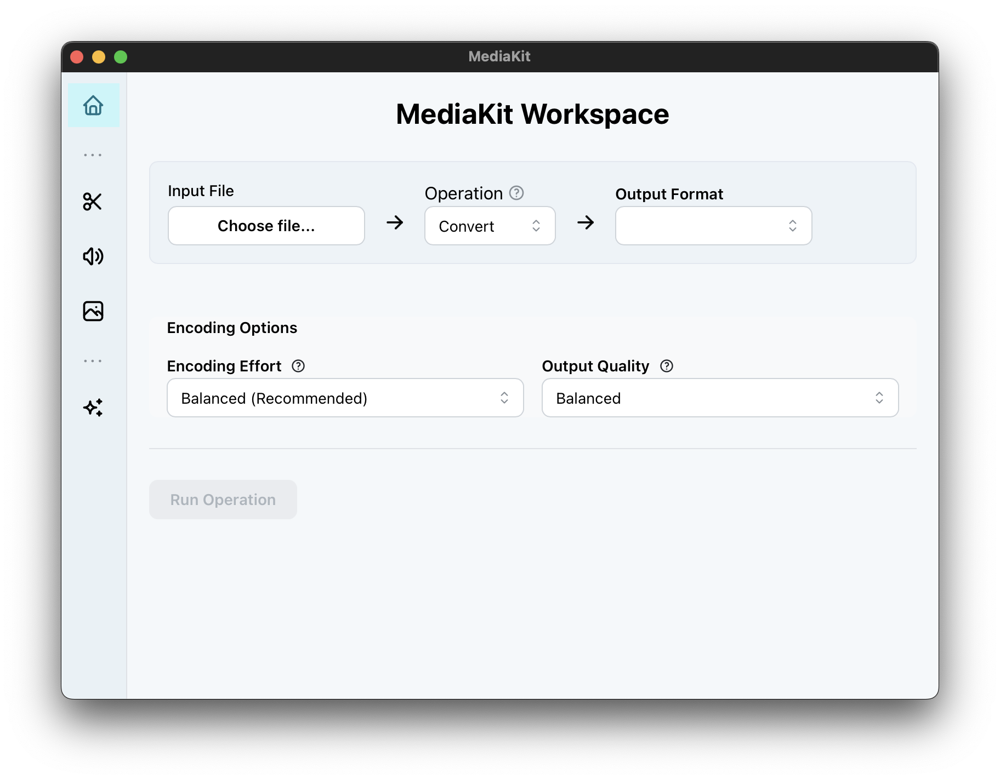
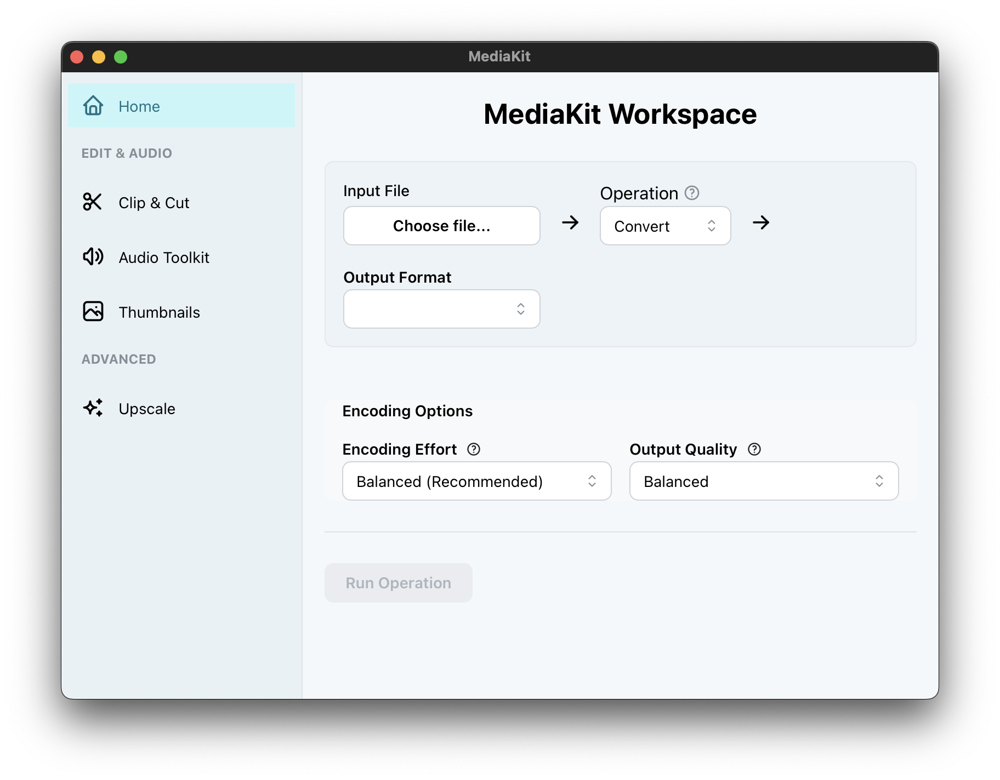
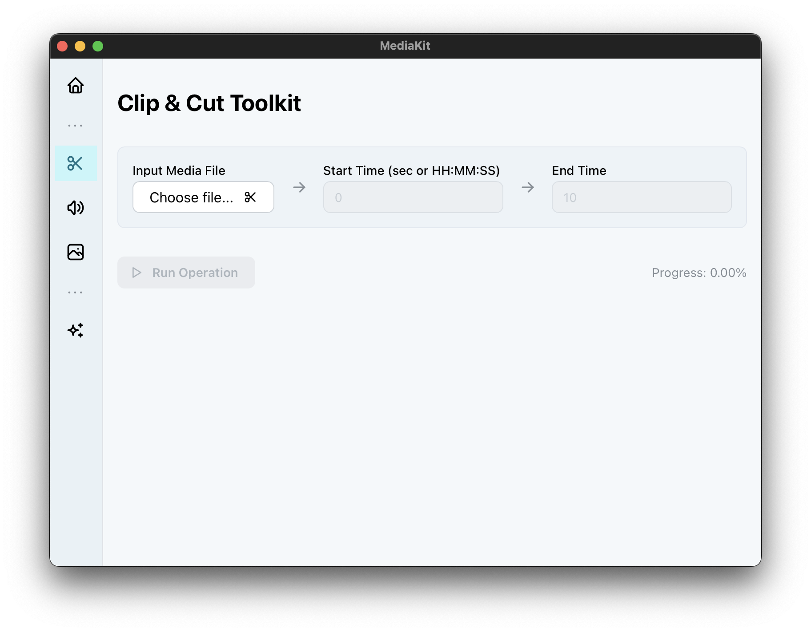
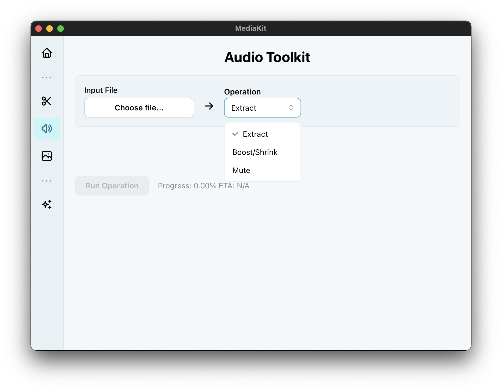
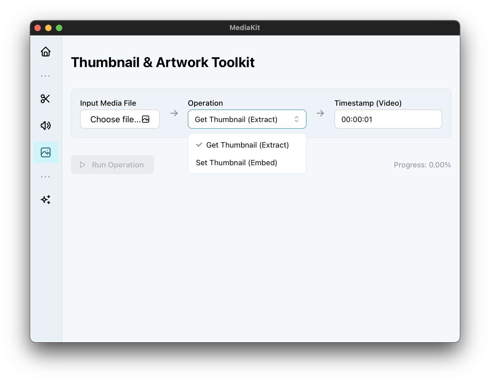

# MediaKit

A lightweight, modern, and clean desktop GUI wrapper for **FFmpeg** and **ImageMagick**, built with Tauri v2, React, TypeScript, and Mantine UI.

## 🎯 Motivation

MediaKit started out as a simple personal project with two main goals:

1. **Replacing Bash Scripts:** I wanted a straightforward desktop GUI to replace the collection of shell scripts I was using for everyday tasks—such as format conversion, video compression, audio extraction and volume boosting, stream-copy clipping, thumbnail management, 4K GPU upscaling, and lossless/modern image conversion (AVIF, WebP, PNG)—without having to deal with CRF sliders, pixel formats, or complex encoder presets. Instead, it maps those parameters to straightforward dropdowns like **Output Quality** (*Visually Lossless*, *Balanced*, *Compressed*) and **Encoding Effort** (*Fastest*, *Fast*, *Balanced*, *Thorough*).
2. **Learning Tauri:** Rather than installing an existing third-party tool, I built this from scratch to gain hands-on experience with Tauri v2, specifically around architecting desktop workflows and bundling standalone CLI binaries as local sidecars.

---

## 📸 Screenshots

<table style="width: 100%; border: none; background: transparent;">
  <!-- ==================== ROW 1: Images 1 to 3 ==================== -->
  <tr>
    <!-- Row 1, Cell 1: Home Workspace 1 -->
    <td style="width: 33.33%; vertical-align: bottom; text-align: center; padding: 5px;">
      <a href="./images/homepage-1.png" target="_blank">
        
      </a>
    </td>
    <!-- Row 1, Cell 2: Home Workspace 2 -->
    <td style="width: 33.33%; vertical-align: bottom; text-align: center; padding: 5px;">
      <a href="./images/homepage-2.png" target="_blank">
        
      </a>
    </td>
    <!-- Row 1, Cell 3: Clip & Cut Toolkit -->
    <td style="width: 33.33%; vertical-align: bottom; text-align: center; padding: 5px;">
      <a href="./images/clip-cut-page.png" target="_blank">
        
      </a>
    </td>
  </tr>

  <!-- ==================== ROW 1: Captions 1 to 3 ==================== -->
  <tr>
    <!-- Row 1, Cell 1 Caption -->
    <td style="width: 33.33%; vertical-align: top; text-align: center; padding: 5px; font-style: italic; font-size: 0.85em;">
      Home workspace on initial launch with collapsed sidebar and clean 3-step conversion pipeline.
    </td>
    <!-- Row 1, Cell 2 Caption -->
    <td style="width: 33.33%; vertical-align: top; text-align: center; padding: 5px; font-style: italic; font-size: 0.85em;">
      Expanded sidebar navigation showcasing structured app categories and workspace views.
    </td>
    <!-- Row 1, Cell 3 Caption -->
    <td style="width: 33.33%; vertical-align: top; text-align: center; padding: 5px; font-style: italic; font-size: 0.85em;">
      Clip & Cut workspace for fast, zero-re-encode stream-copy cutting using flexible timecodes.
    </td>
  </tr>

  <!-- ==================== ROW 2: Images 4 to 5 ==================== -->
  <tr>
    <!-- Row 2, Cell 1: Audio Toolkit -->
    <td style="width: 33.33%; vertical-align: bottom; text-align: center; padding: 5px; padding-top: 20px;">
      <a href="./images/audio-page.png" target="_blank">
        
      </a>
    </td>    
    <!-- Row 2, Cell 2: Thumbnails & Artwork -->
    <td style="width: 33.33%; vertical-align: bottom; text-align: center; padding: 5px; padding-top: 20px;">
      <a href="./images/thumbnail-page.png" target="_blank">
        
      </a>
    </td>
    <!-- Row 2, Cell 3: Empty spacer for alignment -->
    <td style="width: 33.33%;"></td>
  </tr>

  <!-- ==================== ROW 2: Captions 4 to 5 ==================== -->
  <tr>
    <!-- Row 2, Cell 1 Caption -->
    <td style="width: 33.33%; vertical-align: top; text-align: center; padding: 5px; font-style: italic; font-size: 0.85em;">
      Audio Toolkit module with the operation dropdown expanded to showcase extraction and volume controls.
    </td>
    <!-- Row 2, Cell 2 Caption -->
    <td style="width: 33.33%; vertical-align: top; text-align: center; padding: 5px; font-style: italic; font-size: 0.85em;">
      Thumbnails & Artwork module with operation dropdown open for frame extraction and cover art embedding.
    </td>
    <!-- Row 2, Cell 3 Caption -->
    <td style="width: 33.33%;"></td>
  </tr>
</table>

---

## 🚀 Core Workspace & Dynamic Routing

At the heart of MediaKit is the **Home Workspace**, designed around a frictionless 3-step pipeline (`[Input File] → [Operation] → [Output Format]`):

* **Smart Type Detection:** When you drop or select a file, MediaKit automatically inspects its type (`audio`, `video`, or `image`) and dynamically populates the available format selector:
  * **Video Formats:** `mp4`, `mkv`, `mov`, `webm`
  * **Audio Formats:** `mp3`, `m4a`, `wav`, `opus`
  * **Image Formats:** `jpg`, `jpeg`, `avif`, `webp`, `png`
* **Under-the-Hood Routing:** Depending on whether your input is media or static graphics, MediaKit seamlessly routes execution between optimized sidecar binaries (`mediaProcessor` for A/V streams and `imageProcessor` for high-speed image compression).

---

## 🛠️ Features & Modules

- **Image Conversion & Compression (`imageProcessor`):** Effortlessly convert and compress static images across standard web formats (`.jpg`, `.png`, `.webp`, `.avif`) using optimized ImageMagick flags (`-strip`, adaptive filtering, and custom zlib compression levels) while keeping output sizes minimal.
- **Clip & Cut Toolkit:** Fast, zero-re-encode stream-copying (`-c copy`) for video and audio cuts using flexible timecode inputs. Includes automatic timestamp offset correction (`-avoid_negative_ts make_zero`) to ensure native player compatibility across macOS and Windows.
- **Audio Toolkit:** Extract audio tracks, normalize volume, or strip audio streams from media containers instantly.
- **Thumbnails & Extraction:** Quickly generate sequential frame thumbnails or extract cover artwork from video containers.
- **Video Upscaling:** Access video upscaling workflows, balancing processing effort against output resolution.
- **Native Local Performance:** Powered by Tauri v2 with secure local sidecar execution, ensuring zero cloud dependencies, full privacy, and maximum hardware utilization.

---

## 💻 Tech Stack

- **Desktop Framework:** Tauri v2 (Rust backend, webview frontend)
- **Frontend:** React 19, TypeScript, Vite, Mantine UI, Tabler Icons
- **Binaries:** Custom-branded local sidecars (`mediaProcessor` powered by FFmpeg, `imageProcessor` powered by ImageMagick)

---

## ⚙️ How to Run & Troubleshooting

Because MediaKit is distributed as an independent open-source utility without paid Apple/Microsoft developer certificates, your operating system may flag the first launch. Here is how to run it smoothly:

### MacOS
If macOS prompts that *"MediaKit can't be opened because it is from an unidentified developer"* or is damaged:
1. Move `MediaKit.app` into your **Applications** folder.
2. Open your terminal and strip the quarantine attribute applied by Gatekeeper:

   ```bash
   sudo xattr -d com.apple.quarantine /Applications/MediaKit.app
   ```

### Windows
If Windows Defender SmartScreen prevents the executable from starting (Windows protected your PC):
1. Click on the "More info" link in the warning popup.
2. Click the "Run anyway" button that appears at the bottom.